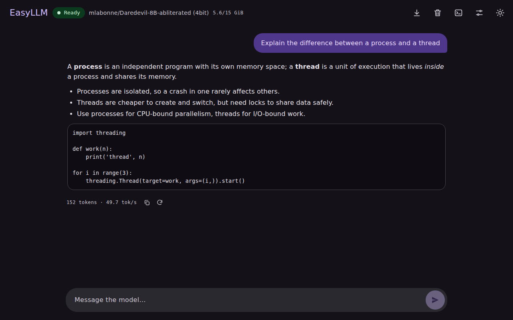
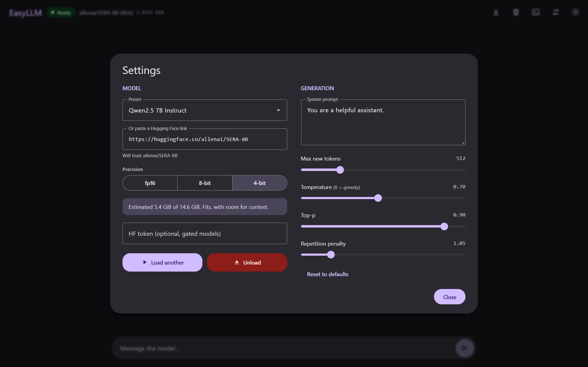
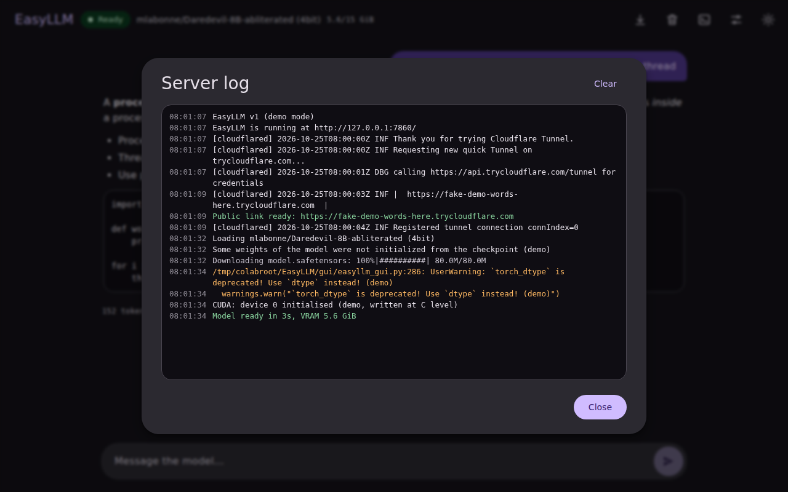

# EasyLLM

[](https://colab.research.google.com/github/AlamandaCathartica/EasyLLM/blob/main/GUI_LLM.ipynb)

A simple chat interface for running **LLMs up to 13B** on a small GPU. It runs in Google Colab (the free T4 works) or on your own machine, and keeps everything in one page: pick a model, load it in 4-bit, chat, and watch what the engine is doing.



## What it does

**Load**
- Ready-made presets from 3B to 13B, or paste any Hugging Face link (for example `https://huggingface.co/allenai/SERA-8B`).
- fp16, 8-bit or 4-bit (NF4). A live estimate tells you whether the model fits your GPU before you press Load.
- Gated models work with a Hugging Face token (Colab secret `HF_TOKEN`, or the field in Settings).



**Chat**
- Wide chat view with streaming replies, Markdown and code blocks, copy, regenerate and stop.
- System prompt, max new tokens, temperature, top-p and repetition penalty in the Settings dialog.
- Tokens and speed shown under each reply. Export or clear the chat any time.

**See everything**
- The **log** button shows all of the engine's output: Python prints and warnings, Hugging Face download progress, bitsandbytes/CUDA messages and the Cloudflare tunnel.



## How to use it

1. Open the Colab link at the top and choose a **T4 GPU** runtime.
2. Run the cell and open the private link it prints.
3. Pick a model or paste a link, choose **4-bit** for 7B and larger, and press **Load model**.

You do not need to upload any files. The engine and GUI are downloaded from this repository each time you run the cell, and the link is protected by a private key.

## Run it locally

```
pip install -r requirements.txt     # plus a CUDA build of torch
python gui/easyllm_gui.py
```

Then open `http://127.0.0.1:7860`. To look around without a GPU, run `python gui/easyllm_gui.py --demo`, which simulates a model.

## Repository layout

| Path | What it is |
|---|---|
| `GUI_LLM.ipynb` | The only notebook: clones this repo, installs requirements, starts the GUI and the tunnel |
| `gui/easyllm_gui.py` | The engine and server (loads models, streams chat, collects the log) |
| `gui/web/index.html` | The web page |
| `gui/tunnel.py` | Cloudflare quick tunnel helper |
| `VERSION` | Shown in the notebook output and the server log |
